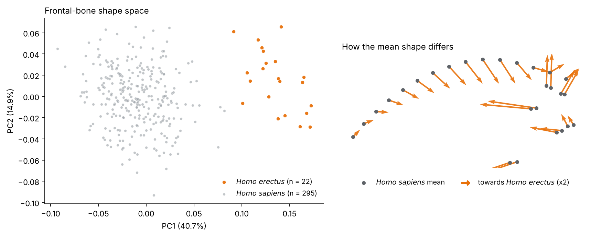

# gmm-core

**Transparent, tested geometric morphometrics in Python, from landmark files to permutation-based shape statistics.**

[](https://github.com/gbravomorante/gmm-core/actions/workflows/tests.yml)


`gmm-core` is the numerical core of a desktop application I build and use for 3D shape analysis.
It covers the stages where analyses most often go wrong without anyone noticing: reading
landmark files, aligning them, checking them, and testing them honestly.



<sub>A full analysis of a public dataset (Baab, 2021; CC0) in one short script:
[`examples/homo_erectus_frontal.py`](examples/homo_erectus_frontal.py). Species differ in
frontal shape after accounting for size (RRPP, R² = 0.24, p = 0.001). The built-in checks
also flag, unprompted, two specimens about 2.9× larger than the rest, which is the signature
of a unit error in the source files.</sub>

## Design principles

- **Nothing disappears silently.** Every importer and check writes to one validation table.
  Rows are flagged, never dropped; a specimen with the wrong landmark count is excluded *and
  reported*, never padded.
- **No black boxes.** Procrustes alignment, RRPP and the reconstruction methods are implemented
  directly, in short functions you can read and check against the literature.
- **Warnings that make an analyst look.** Group tests warn about unbalanced or tiny groups, size
  differences that could be allometry, groups entangled with observers, and size gaps that look
  like unit errors. They warn and proceed; they never block.
- **Estimates stay estimates.** Reconstructed landmarks are always flagged and never mixed
  silently with observed coordinates.

## What's inside

| Module | What it does |
| --- | --- |
| `gmm_core.io` | Importers for Excel, long/wide CSV and TXT, TPS, Morphologika, Amira `.landmarkAscii` and 3D Slicer (`.mrk.json`, `.fcsv`). Each reports declared units, LPS/RAS coordinate systems, duplicate IDs and malformed files. |
| `gmm_core.gpa` | Generalized Procrustes analysis, scaled or rigid, with proper rotations only, plus centroid size and pairwise Procrustes distances. |
| `gmm_core.qc` | Post-alignment checks: centroid-size and Procrustes-distance outliers, unit anomalies and size gaps. |
| `gmm_core.analysis` | PCA in one shared morphospace, allometry (with any size variable), group differences with covariates, and measurement error (TEM, %TEM, repeatability). All inference uses RRPP. |
| `gmm_core.missing_data` | Coverage tables, landmark-drop planning, distances on shared landmarks, and staged reconstruction with error validated on simulated damage. |
| `gmm_core.reconstruction` | Iterative PCA-based reconstruction of missing landmarks (Gunz et al., 2009). |
| `gmm_core.mesh_warp` | Similarity fits and thin-plate-spline warping of a reference mesh to any shape. |

## Install

```bash
pip install "gmm-core @ git+https://github.com/gbravomorante/gmm-core"
```

## Quick start

```python
from gmm_core import (
    import_tabular_files, extract_landmark_array, generalized_procrustes, fit_pca,
)

data = import_tabular_files(["landmarks.csv"])   # layout, delimiter and dimensions are detected
print(data.validation)                           # everything that was flagged, and why

shapes = extract_landmark_array(data.raw, data.landmark_cols, data.n_dim)
gpa = generalized_procrustes(shapes, scale=True)
print(gpa.converged, gpa.iterations, gpa.centroid_sizes[:5])
```

The [example](examples/homo_erectus_frontal.py) continues from there through PCA, a group test
with a size covariate, and the figure above.

## Tests

```bash
pip install -e ".[dev]"
pytest
```

The suite has about 300 tests. They check results against known geometry and statistics:
invariance of GPA to translation, rotation and scale, no silent reflections, recovery of
landmarks hidden from complete specimens, and RRPP that detects real effects but stays
calibrated under the null. They also pin the warnings described above to the situations that
triggered them in real analyses.

## Scope

This repository is the open, framework-free core. The desktop application built on it, with
its interactive interface, automated 3D landmarking and newer analysis modules, is still in
development and not public. Semilandmark sliding is not part of this package yet.

## Feedback and contributions

Bug reports and questions are welcome as [GitHub issues](https://github.com/gbravomorante/gmm-core/issues).
For a pull request, please open an issue first for anything beyond a small fix, and make sure
`pytest && ruff check .` passes.

## License

[MIT](LICENSE) © Guillermo Bravo Morante · [gbravomorante.dev](https://gbravomorante.dev)
